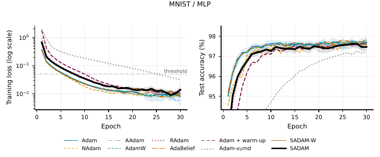
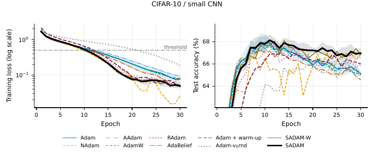
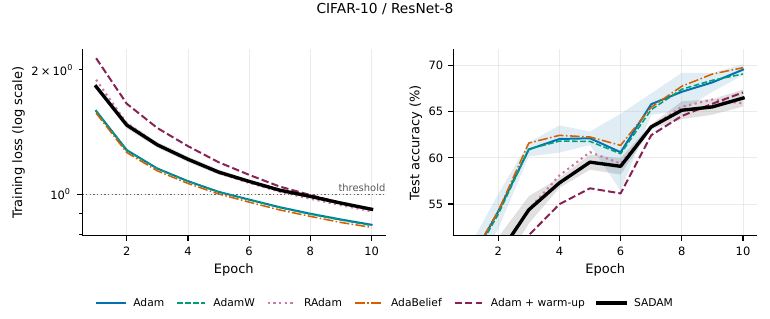
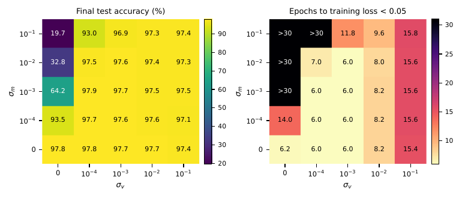
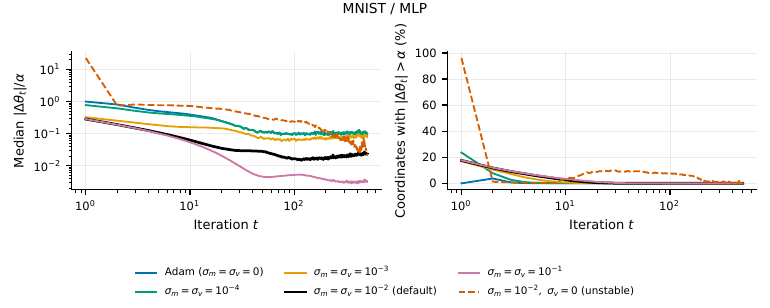

# SADAM: Gaussian moment-state initialization for Adam


[](https://colab.research.google.com/github/alilouati/sadam-gaussian/blob/main/SADAM_demo.ipynb)

Code, raw logs, figures, and tests for the paper
**"Gaussian-Based Moment-State Initialization for Adaptive Optimization in Machine Learning"**
(A. Louati, H. Louati, E. Kariri; IEEE Access, under review).

SADAM is Adam with random initial moment states: the first moment starts from
m0 ~ N(0, σm²) and the second moment from v0 = z², z ~ N(0, σv²) (default σm = σv = 0.01).
All later updates are those of Adam. The analysis in the paper shows that v0 acts as an implicit,
coordinate-wise learning-rate warm-up whose length depends on σv relative to the gradient scale.

All experiments use a NumPy implementation (float32, explicit backward passes checked against
finite differences) and run on a CPU; no deep-learning framework is needed.

## Run it in the browser (Google Colab)
Click **Open in Colab** above, then **Runtime → Run all** (about 3–5 minutes, CPU is enough). The notebook
installs the code, runs the test suite, shows SADAM's implicit warm-up, regenerates all tables and figures of the
paper from the raw logs, lets you train Adam and SADAM with your own σm and σv, and re-runs real MNIST training
for comparison with the logged results.

## Quick start (local)
```bash
git clone https://github.com/alilouati/sadam-gaussian.git
cd sadam-gaussian
pip install -r requirements.txt pytest
pytest -v                      # 16 tests, about 15 s
```
The tests check the initialization, the closed form of Lemma 1 at t = 1 (factors 9 and 999),
that σm = σv = 0 recovers Adam exactly, the backward pass of every layer, that all ten
optimizers train a small network, and that the paper's tables are regenerated exactly from the logs.

## Reproduce the tables and figures from the logs (about 1 minute)
```bash
cd code
python npanalyze.py                         # tables  -> outputs/tables
python replot.py                            # figures -> outputs/figs
python theory_and_digits/digits_report.py   # UCI-digits table
```

## Re-run the experiments (CPU; several days on two cores)
```bash
./get_data.sh            # MNIST and CIFAR-10 from public GitHub mirrors into ./data
cd code
python runqueue.py       # all 287 runs (E1-E3, E5), two in parallel, written to ../results
python gradrms.py
python theory_and_digits/theory_check.py ../results/digits/theory_check.json
python theory_and_digits/digits_sensitivity.py ../results/digits/digits_results.json
```
One run: `python run.py --dataset mnist --model mlp --opt sadam --seed 0 --epochs 30 --bs 256 --out ../results/E1`

With single-threaded BLAS (`OPENBLAS_NUM_THREADS=1`, set by `runqueue.py`) a re-run reproduces the
logged values exactly. The data location can be changed with `SADAM_DATA`.

## Contents
| Path | Content |
|---|---|
| `code/optim.py` | Adam, NAdam, AAdam, AdamW, RAdam, AdaBelief, Adam + warm-up, Adam-v0rnd, SADAM, SADAM-W |
| `code/nn.py` | MLP, small CNN, ResNet-8 (NumPy layers with explicit backward passes) |
| `code/run.py`, `code/runqueue.py` | one training run; the full paired run list |
| `code/gradcheck.py` | finite-difference check of every layer |
| `code/npanalyze.py`, `code/replot.py` | tables, paired statistics (Holm-corrected), figures |
| `code/theory_and_digits/` | Monte Carlo checks of the propositions; 500-run UCI-digits sensitivity study |
| `results/` | raw per-run JSON logs (E1 MNIST/MLP, E2 CIFAR-10/CNN, E3 CIFAR-10/ResNet-8, E5 sensitivity, digits) |
| `figures/`, `tables/` | the figures and tables as they appear in the paper |
| `SADAM_demo.ipynb` | Colab notebook: run, test and reproduce |
| `tests/` | test suite (also run automatically by GitHub Actions on every push) |

Paired design: for a given seed every optimizer starts from the same weights and sees the same
mini-batch order, so differences are due to the optimizer only.

## Results (figures from the paper)
**MNIST / MLP**

**CIFAR-10 / small CNN**

**CIFAR-10 / ResNet-8**

**Sensitivity to σm and σv (MNIST)**

**Early-iteration step sizes (MNIST)**


## Citation
If you use this code, please cite the paper (reference will be added on publication).
